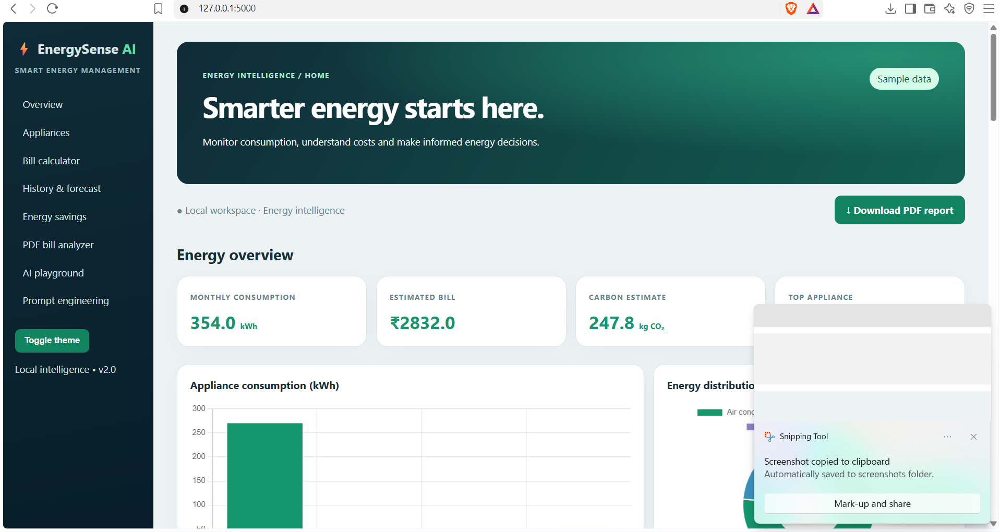
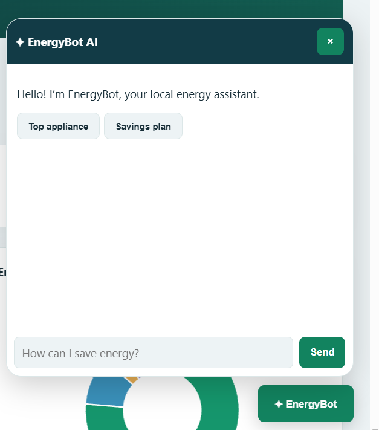
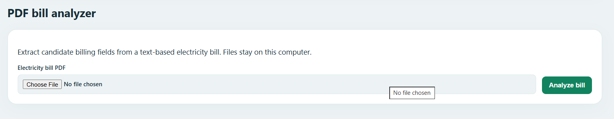
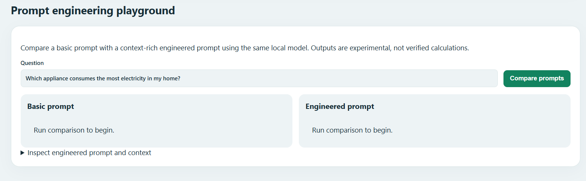
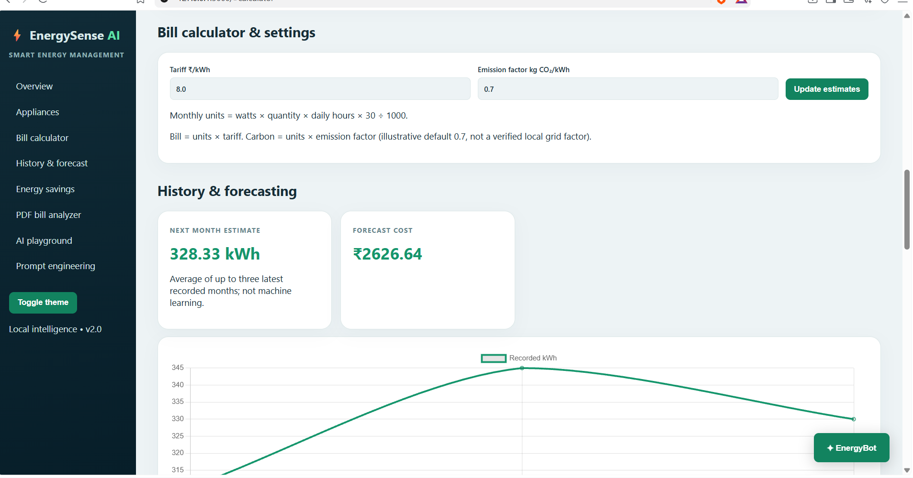
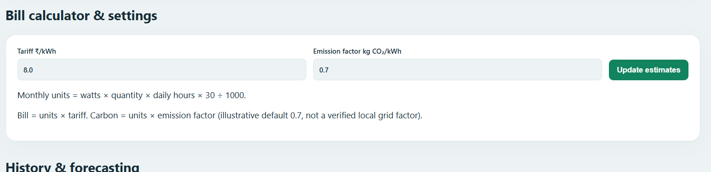

\# ⚡ EnergySense AI v2.0

\### Smarter Energy Starts Here

EnergySense AI is an AI-powered smart electricity management

application designed to help households monitor electricity

consumption, understand energy costs and make informed

energy-saving decisions.

The application integrates a locally running Generative AI

model using Ollama and Qwen2.5, eliminating the need for

external AI API keys.

\## 🚀 Key Features

\- Interactive energy analytics dashboard

\- Appliance management system

\- Electricity bill calculator

\- Monthly consumption history and forecasting

\- Carbon footprint estimation

\- Personalized energy-saving recommendations

\- EnergyBot AI chatbot

\- PDF electricity bill analyzer

\- Downloadable PDF energy reports

\- Prompt Engineering Playground

\- Basic vs engineered prompt comparison

\- Dark and light mode

\- Responsive user interface

\## 🎯 Problem Statement

Households often lack detailed information about their

electricity consumption and the contribution of individual

appliances to their monthly electricity bills.

EnergySense AI addresses this problem through energy

analytics, document processing and personalized AI-assisted

recommendations.

\## 🛠️ Technology Stack

| Component | Technology |

|-----------|------------|

| Frontend | HTML, CSS, JavaScript |

| Backend | Python, Flask |

| Database | SQLite |

| Generative AI | Qwen2.5 3B |

| Local AI Engine | Ollama |

| Visualization | Chart.js |

| PDF Processing | PyMuPDF |

| Report Generation | ReportLab |

| Development IDE | Cursor AI |

\## 🧠 Prompt Engineering Techniques

\- Role Prompting

\- Contextual Prompting

\- Few-shot Prompting

\- Structured Prompting

\- Domain Guardrails

\- Response Constraints

The Prompt Engineering Playground compares basic and

context-rich engineered prompts using the same AI model.

\## 🏗️ System Architecture

User Interface

&#x20;   |

Flask Backend

&#x20;   |

&#x20;   +-- SQLite Database

&#x20;   +-- Energy Calculation Engine

&#x20;   +-- PDF Processing Module

&#x20;   +-- Prompt Engineering Module

&#x20;             |

&#x20;        Ollama API

&#x20;             |

&#x20;        Qwen2.5 3B

\## 📊 Sample Demonstration Results

| Metric | Sample Result |

|--------|---------------|

| Monthly consumption | 354 kWh |

| Estimated monthly bill | INR 2,832 |

| Highest consuming appliance | Air conditioner |

| Potential monthly savings | INR 360 |

| Potential annual savings | INR 4,320 |

| Estimated bill reduction | 12.71% |

These results are based on illustrative sample data.

Actual savings depend on usage patterns and electricity rates.

\## ⚙️ Installation

\### Prerequisites

\- Python 3.12

\- Git

\- Ollama

\- Internet connection for initial model download

\### 1. Clone the repository

git clone <YOUR\_REPOSITORY\_URL>

cd EnergySense-AI

\### 2. Create a virtual environment

py -3.12 -m venv .venv

\### 3. Install dependencies

.\\.venv\\Scripts\\python.exe -m pip install -r requirements.txt

\### 4. Download the local AI model

ollama pull qwen2.5:3b

\### 5. Run the application

.\\.venv\\Scripts\\python.exe app.py

\### 6. Open the website

http://127.0.0.1:5000

## 📸 Project Screenshots

### Energy Analytics Dashboard

### EnergyBot AI Chatbot

### PDF Bill Analyzer

### Prompt Engineering Playground

### Dark Mode

### Electricity Bill Calculator

\## 🔒 Privacy

\- AI inference runs locally through Ollama.

\- No external AI API key is required.

\- Electricity bill analysis is performed locally.

\- Personal electricity bills should not be committed

&#x20; to the public repository.

\## ⚠️ Limitations

\- AI-generated responses may contain inaccuracies.

\- Forecasts are estimates, not guaranteed predictions.

\- PDF extraction supports text-based documents.

\- Scanned bills requiring OCR are not supported.

\- The local AI model requires sufficient system resources.

\- The application is currently a local prototype.

\## 🔮 Future Scope

\- Smart meter integration

\- IoT-based real-time monitoring

\- Advanced machine learning forecasting

\- OCR-based electricity bill analysis

\- Multi-user authentication

\- Cloud deployment

\- Mobile application

\## 🎓 Academic Project

Developed as a Prompt Engineering academic project,

demonstrating the practical application of Generative AI

in household electricity management.

\## 🙌 Acknowledgements

Python, Flask, SQLite, Ollama, Qwen and the

open-source developer community.

